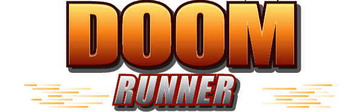

<h3 align="center">Those fake mobile game ads … but it's DOOM. A GZDoom mod.</h3>

> ## ⚠ STRONGLY RECOMMENDED
> ## Play with the original **DOOM2.WAD** and **[BRUTAL DOOM](https://www.moddb.com/mods/brutal-doom)**!

**Website & download:** https://bockwurstwilly.github.io/doom-runner/

## Play (Windows)

1. Download `DoomRunner-Windows.zip` from the latest release and extract it.
2. Double-click **`Doom Runner.bat`** – it runs right away with the included Freedoom.
3. **Recommended:** copy your `DOOM2.WAD` (Steam/GOG Doom II folder) into the extracted folder.
4. **Recommended:** download [Brutal Doom](https://www.moddb.com/mods/brutal-doom) and put its `brutal*.pk3` into the same folder.

The launcher picks up `DOOM2.WAD` and `brutal*.pk3` automatically.
The game itself can be switched between English and German in the main menu.
Already have GZDoom? Just load `DoomRunner.pk3` (after Brutal Doom) with Doom II.

## Build from source

`python build.py` creates `DoomRunner.pk3` from `src/` (no dependencies). `tools/*.ps1` re-render the logo and font.

## Credits

- **Doom Runner** by **BockwurstWilly** – licensed [CC BY-NC 4.0](LICENSE.md). Feel free to use parts in your own mods – just credit BockwurstWilly.

- Engine: [GZDoom](https://github.com/ZDoom/gzdoom) (GPLv3), shipped unmodified in the Windows package.
- Free IWAD: [Freedoom](https://freedoom.github.io) (modified BSD), shipped in the Windows package.
- Doom II and Brutal Doom are **not** included and belong to their respective owners.
  Doom Runner is a fan project, not affiliated with id Software or Bethesda.
